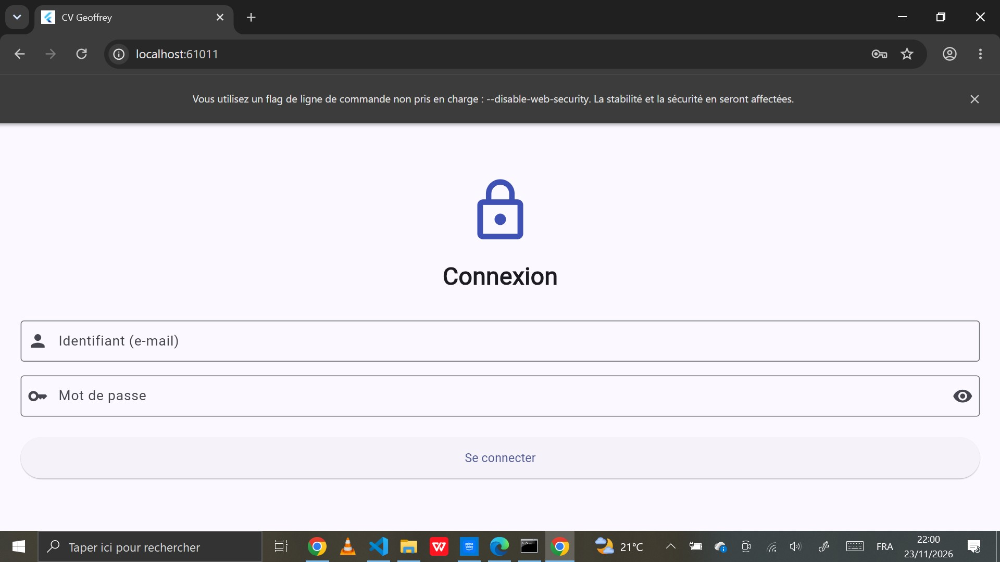
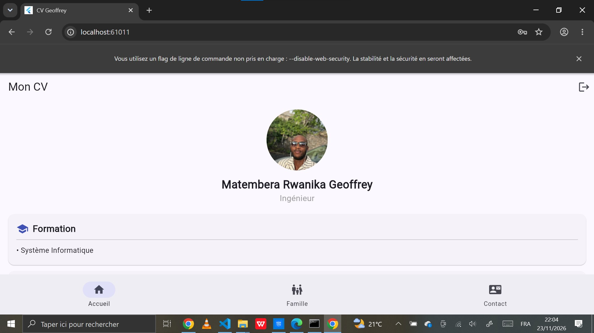
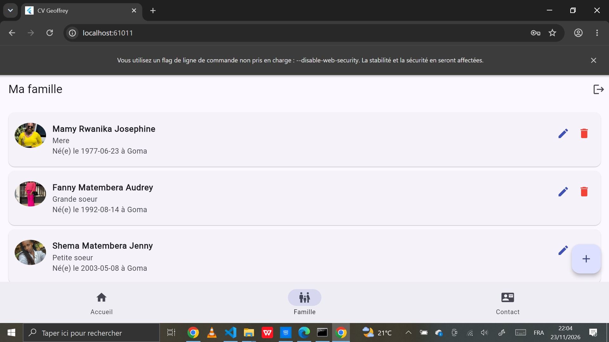
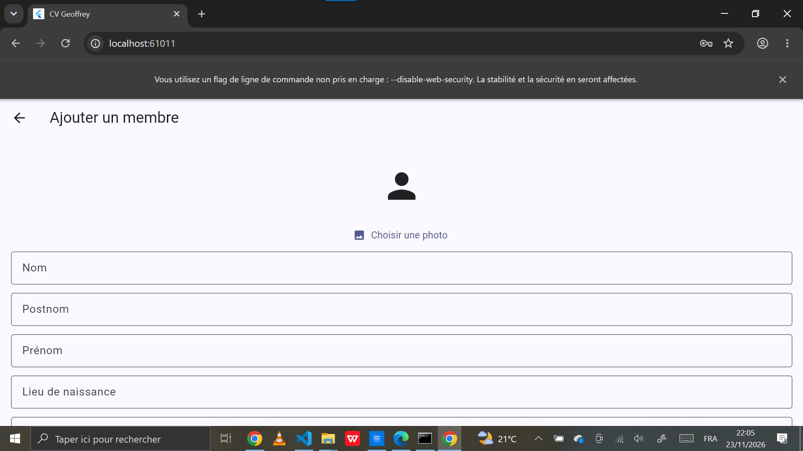
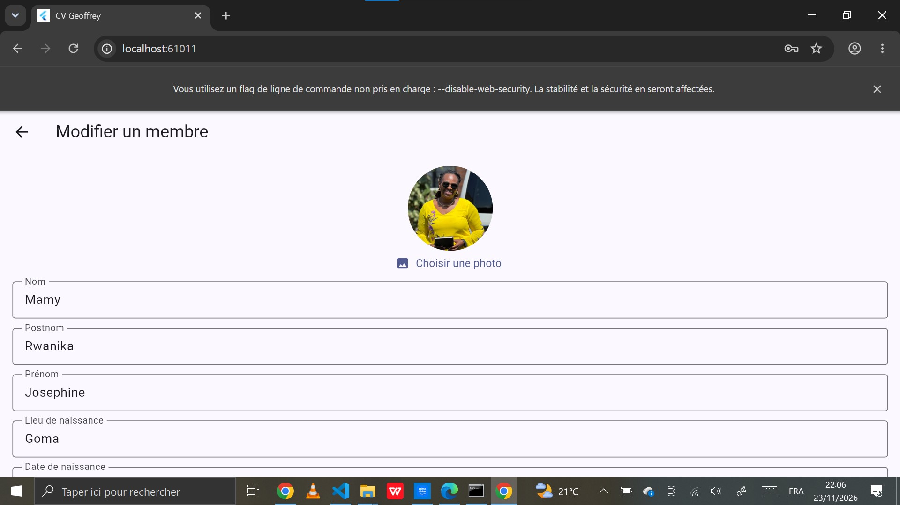
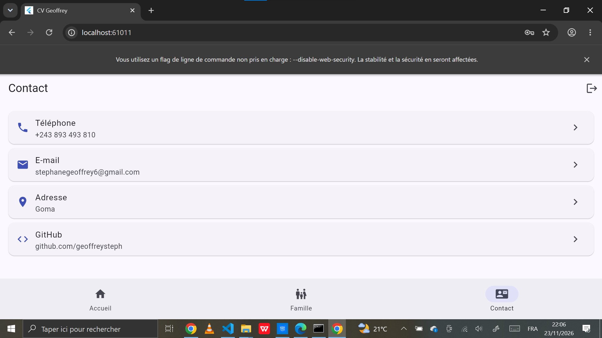

# CV Flutter - Matembera Rwanika Geoffrey

Application mobile Flutter qui présente mon CV, ma famille et mes coordonnées.
Dans ce TP2, la **connexion** et la **gestion des membres de la famille** passent par une **API REST** (PHP) reliée à une base de données **MySQL**.

## Fonctionnalités

- Connexion réelle via l'API (`POST /accounts/login`)
- Page d'accueil : CV complet (photo, titre, formation, expériences, compétences, langues, centres d'intérêt)
- Page famille : liste, **ajout**, **modification** et **suppression** de membres, avec photo (données enregistrées en base MySQL)
- Page contact : téléphone, e-mail, adresse et GitHub cliquables
- Navigation par barre inférieure

## Technologies

- Flutter / Dart (packages : `http`, `image_picker`, `url_launcher`)
- API REST en PHP : [espoirbaraka/api-test](https://github.com/espoirbaraka/api-test)
- Base de données MySQL (WampServer)

## Vidéo de démonstration

[▶️ Voir la vidéo de démonstration](https://www.youtube.com/watch?v=TT_jadHiWTg)

## Captures d'écran

### 1. Connexion


### 2. Accueil (CV)


### 3. Famille (données venant de l'API)


### Ajout d'un membre


### Modification d'un membre


### 4. Contact


## Installation

### 1. API et base de données
1. Démarrer WampServer (Apache et MySQL).
2. Placer le dossier `api-test` dans `C:\wamp64\www\`.
3. Dans phpMyAdmin, créer la base `api` puis importer le fichier `api.sql`.
4. Vérifier le fichier `.env` de l'API (`DB_DATABASE=api`, `DB_USERNAME=root`).
5. Créer un compte de connexion :
   ```
   curl.exe -X POST http://localhost:8080/api-test/public/accounts/register -H "Content-Type: application/json" -d "{\"email\":\"votre@email.com\",\"password\":\"motdepasse\"}"
   ```

### 2. Application Flutter
```
git clone https://github.com/geoffreysteph/cv_flutter_geoffrey.git
cd cv_flutter_geoffrey
flutter pub get
flutter run -d chrome --web-browser-flag "--disable-web-security"
```

L'adresse de l'API se règle dans `lib/api_service.dart` (`baseUrl`) :
- Chrome / Windows : `http://localhost:8080/api-test/public`
- Émulateur Android : remplacer `localhost` par `10.0.2.2`
- Téléphone réel : remplacer `localhost` par l'adresse IP du PC

## Structure du code (`lib/`)

| Fichier | Rôle |
|---|---|
| `main.dart` | Point d'entrée |
| `login_page.dart` | Page de connexion (API) |
| `main_page.dart` | Navigation entre les pages |
| `home_page.dart` | Page d'accueil (CV) |
| `family_page.dart` | Liste, modification et suppression des membres |
| `membre_form_page.dart` | Formulaire d'ajout / modification |
| `contact_page.dart` | Page de contact |
| `api_service.dart` | Appels à l'API REST |
| `membre.dart` | Modèle d'un membre |

## Auteur

Matembera Rwanika Geoffrey - Ingénieur en Système Informatique
